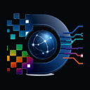
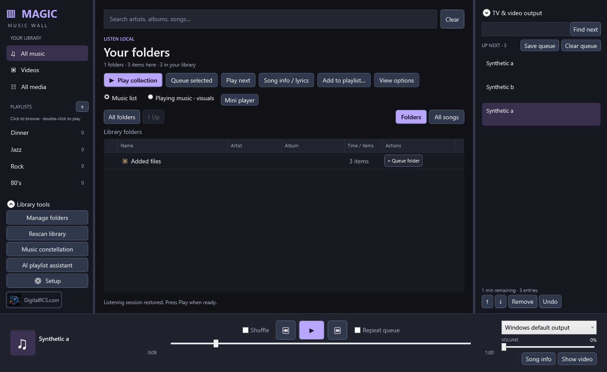
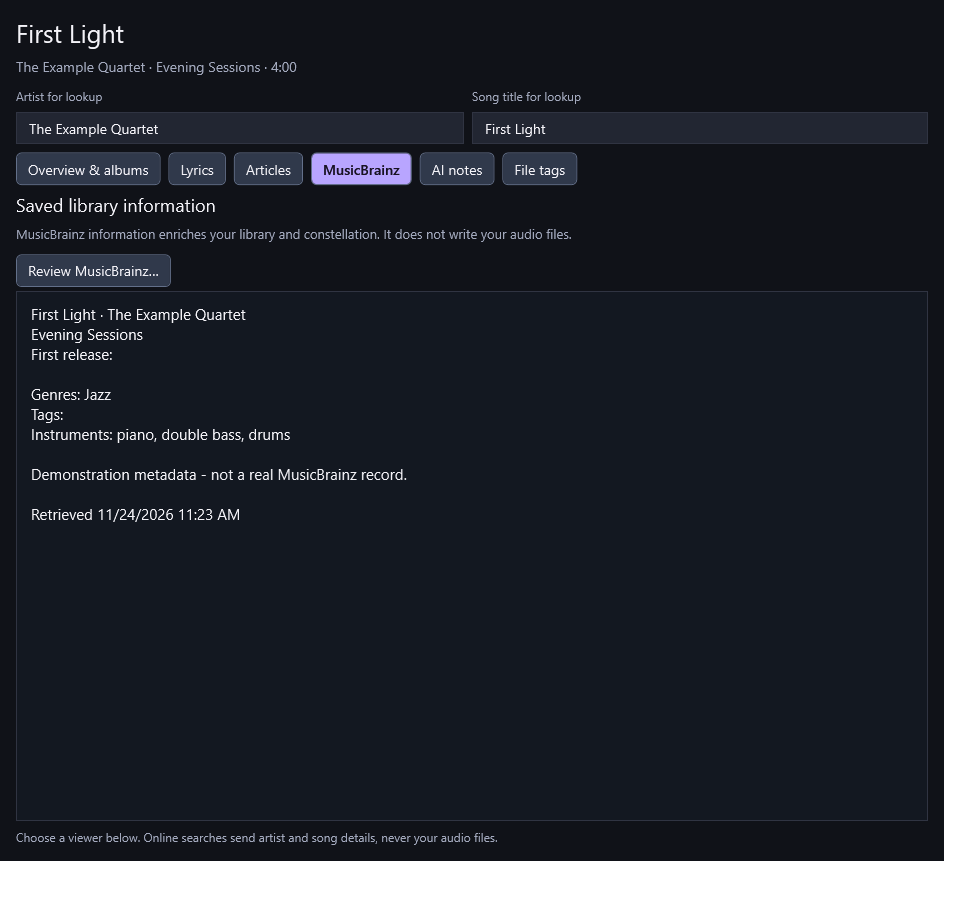
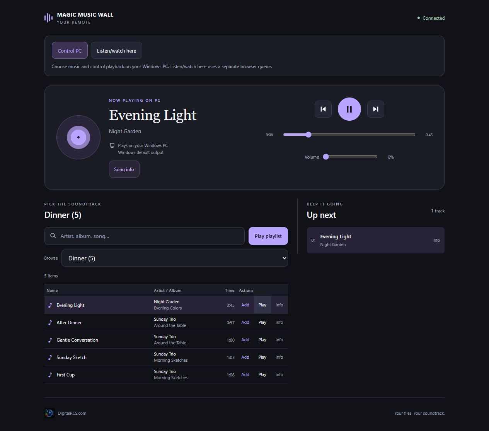

  
  <h1>Magic Music Wall</h1>
  
Your music. Your folders. Your home stereo.

  
A Windows music and video library from <a href="https://digitalrcs.com">DigitalRCS.com</a>.

Add the music and videos you already own, browse a compact folder/file grid, build playlists, and play through your PC speakers or connected Bluetooth stereo. Open the included web page on a phone to control the PC—or listen and watch directly in that browser.

## What is new in 1.0

Keep your listening session between launches, edit the queue with undo, browse favorites and smart playlists, and control large queues from your phone. Adjustable panels and tabbed song details make everyday controls easier to reach. Private backup/restore, library health tools and ReplayGain support help keep an established collection usable. See the [user guide](docs/USER-GUIDE.md) and [release validation](docs/RELEASE-VALIDATION.md) for behavior and test limits.

## Download version 1.0.2

For **Windows 11 on Intel/AMD x64 PCs**. The .NET runtime and VLC playback engine are included; no separate runtime installation is needed.

| Package | What to do |
| --- | --- |
| [Windows installer](https://github.com/digitalrcs/MagicMusicWall/releases/download/v1.0.2/MagicMusicWall-1.0.2-Setup-x64.exe) | Run it on this PC, or copy it to USB and install on another PC. |
| [Portable ZIP](https://github.com/digitalrcs/MagicMusicWall/releases/download/v1.0.2/MagicMusicWall-1.0.2-Portable-x64.zip) | Extract the whole folder, then open **Start-MagicMusicWall.cmd**. |
| [USB kit](https://github.com/digitalrcs/MagicMusicWall/releases/download/v1.0.2/MagicMusicWall-1.0.2-USB-Kit.zip) | Installer, portable ZIP, offline guides and checksums together. |
| [Checksums](https://github.com/digitalrcs/MagicMusicWall/releases/download/v1.0.2/SHA256SUMS.txt) | Verify the downloaded files. |

[All releases](https://github.com/digitalrcs/MagicMusicWall/releases) · [Install and USB instructions](docs/WINDOWS-INSTALLER.md) · [Full documentation](docs/README.md)

The installer is unsigned. Clean Windows installation and ARM emulation have not been verified. No music, movies, personal library data or API tokens are bundled.

## Start with your music

**New here? Follow the [first-use walkthrough](docs/GETTING-STARTED.md)** from installation to your first playlist and phone connection. See [common questions](docs/FAQ.md) for what the app does and where it saves information.

Download **Setup-x64.exe** from the release assets to install. GitHub's **Source code (zip)** download is for developers, not a ready-to-run player.

1. Connect your stereo or headphones in Windows, then choose the device under **Listening on**.
2. Open **Manage folders**, then choose **Add folders…** or **Add files…**. You can add local storage, a connected USB drive, or an accessible network share.
3. Double-click a folder to browse its contents. Single-click a song to select it, then click **+ Queue** to add just that song to **Up next**. Double-click a song to play its existing queue entry, or append and play it if it is not queued.
4. Press Play. Save the queue as a playlist, or select songs and add them to Dinner, Jazz, Rock, 80's, or your own playlist.

The directory grid shows the folders and files you added to your library. Search across them by title, artist, album, genre or folder name—for example, `Pink Floyd` or `Dark Side of the Moon`. Clearing the queue leaves saved playlists intact.

## What you can do

- **Double-click to play:** choose MagicMusicWall as your Windows default for music files. Opening a song adds it to the current queue, or starts playback if the queue is empty. Choose replace-and-play instead in Setup > Sound. Installer file associations are optional. [File association setup](docs/WINDOWS-INSTALLER.md#double-click-music-files).

- **Watch your music:** switch between the music list and ten live visuals, including spectrum bars, waveform, orbit rings and Star voyage. Adjust the side **Visual power** slider for stronger or gentler animation without changing volume. Collapse **Library tools** for more playlist space. [Playback visuals guide](docs/PLAYBACK-VISUALS.md).

- **Play your own collection:** music and video playback, queue controls, saved playlists, shuffle and repeat. Toggle Shuffle during playback to randomly choose the next unplayed queue entry.
- **Explore your music constellation:** follow an animated spring network of artists, albums and songs, with stronger connections pulling music closer together. Drag names, pause motion, explore Metadata, Sound or Blended similarity, and queue what you discover. Optional local sound analysis keeps cached results and can be cancelled and resumed. [Constellation guide](docs/MUSIC-MAP.md).
- **Add MusicBrainz information:** look up missing details for your library or a selected artist, album or song. Review uncertain matches, refresh saved information, and use available genres, community labels and instrument credits in constellation search and connections. Results stay in the app's library; the [MusicBrainz workflow](docs/METADATA.md#save-musicbrainz-information-in-your-library) explains matching and privacy.
- **Choose an output:** PC audio or a Windows-connected Bluetooth device, plus Chromecast discovery and VLC casting.
- **Use your phone:** sign in with a passphrase at the plain web address and remember that browser, or scan a QR access link. Change PC audio output, shuffle, and repeat from the remote. Select files and folders to queue, add whole folders including subfolders, or clear the active queue. Bordered sections collapse independently and remember your layout. Read wrapped song names, remove queued items, and listen/watch independently in the browser.
- **Find song details:** MusicBrainz recordings and albums, local or LRCLIB lyrics, and attributed Wikipedia facts.
- **Review file tags:** compare current/proposed title, artist, album and more, then save checked fields with an original-file backup. Optional TMDB movie lookup uses your own token.
- **Share a movie:** give a compatible Fire TV/VLC network player a temporary link to one selected file.
- **Carry the app:** portable mode keeps preferences and playlists beside the app; media inside that folder follows it when the USB drive letter changes.

Online lookups are optional and send search text to the selected provider. Media files are not uploaded. Playback works offline when the media is locally available. Alexa, Matter, an ESP32, and an AI service are not required.

## A remote for your home

In **Setup → Remote**, enable the remote and choose the reachable PC address. Set and confirm a remote passphrase of 8–128 characters, then save. Use **Copy web address** to open the plain address on another device and sign in; **Remember this browser for 30 days** avoids re-entering the passphrase on later visits. Existing QR access links also work.

**Control PC** operates the Windows queue; **Listen / watch here** plays an independent stream in that browser after you press Play. Each queued item has **Remove**, and long song/folder names wrap onto multiple lines. On phones, artist and album appear below the song name.

Keep the PC, application and source drives available. Share the passphrase or quick access links only with people you intend to give access. Choose a passphrase unique to this app: the remote uses HTTP on a trusted LAN and is not an internet hosting service. Browser listening and TV sharing send original files, so the receiving device must support their codecs. See the [web remote guide](docs/WEB-REMOTE.md) and [video instructions](docs/USER-GUIDE.md).

## Documentation

| Topic | Guide |
| --- | --- |
| First installation, first song and first playlist | [Get started](docs/GETTING-STARTED.md) |
| Common questions and feature limits | [FAQ](docs/FAQ.md) |
| Installing, USB, updating and uninstalling | [Windows installer and USB](docs/WINDOWS-INSTALLER.md) |
| Folders, searching, queue, playlists and video | [User guide](docs/USER-GUIDE.md) |
| Connected artists, albums and songs | [Music constellation](docs/MUSIC-MAP.md) |
| MusicBrainz library information, lyrics, facts and file tags | [Metadata guide](docs/METADATA.md) |
| Phone control and browser listening | [Web remote](docs/WEB-REMOTE.md) |
| Audio, missing files, network and data recovery | [Troubleshooting](docs/TROUBLESHOOTING.md) |
| Building and packaging the application | [Developer guide](docs/BUILDING.md) |
| Release history | [Changelog](CHANGELOG.md) |

Windows packages include an offline snapshot of the guides and screenshots in **OfflineDocs/index.html**. GitHub has the latest documentation updates, including the new first-use walkthrough and FAQ; already-downloaded packages retain their bundled snapshot. Screenshots use synthetic demonstration content.

## Source and feedback

The application uses .NET 10, WPF, LibVLCSharp, TagLibSharp and QRCoder. The [developer guide](docs/BUILDING.md) separates developer setup from the ready-to-run downloads. Report reproducible problems in [GitHub Issues](https://github.com/digitalrcs/MagicMusicWall/issues); remove access links, tokens and personal paths from reports.

**Copyright © 2026 DigitalRCS.com. All rights reserved.** This repository is public with copyright reserved; no open-source license is granted for the project's source, documentation or branding. See [LICENSE.txt](LICENSE.txt) and [CONTRIBUTING.md](CONTRIBUTING.md). Third-party components retain their own licenses and notices: [third-party notices](THIRD-PARTY-NOTICES.md) and [source provenance](licenses/REDISTRIBUTION.md).

## AI playlists and song notes

Use the optional [AI playlist assistant and saved song notes](docs/AI-PLAYLISTS.md) with LM Studio or your own cloud-provider API key. Recommend from your library, review the results, then queue or play them.
