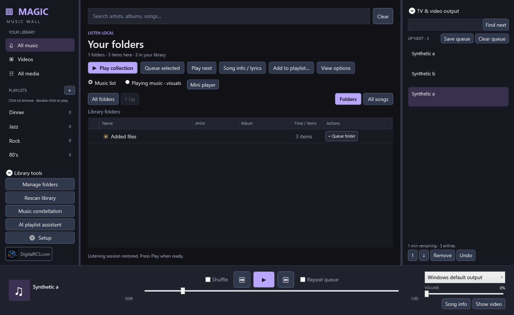

# Get started with Magic Music Wall

Applies to Magic Music Wall **0.9.13**.

[All guides](README.md) · [Download the latest release](https://github.com/digitalrcs/MagicMusicWall/releases/latest)

This walkthrough is for Windows 11 Intel/AMD PCs. Have one folder of your own music ready. Your music stays in its original location; the app saves an index and playlists.

## 1. Install the player

On the release page, expand **Assets** and download the file ending in **Setup-x64.exe**. Close an older running copy, run Setup, and open **Magic Music Wall** from the Start menu. The runtime and playback engine are included.

GitHub's **Source code (zip)** and green **Code** button are for developers. They are not the ready-to-run application. For a USB copy that runs without installation, follow the [portable instructions](WINDOWS-INSTALLER.md#run-the-portable-copy).

The installer is unsigned. Use the official release and follow your PC's security policy. [Installation and updating details](WINDOWS-INSTALLER.md).

## 2. Hear your first song

1. Connect your speakers or pair your Bluetooth stereo in Windows. Confirm another Windows app can play through it.
2. In Magic Music Wall, select that device under **Listening on**. Refresh the device list with **↻** if necessary.
3. Click **Add folder** and choose your music folder. Wait for the scan to finish.
4. In **Folders**, open a folder and click a song's **+ Queue**. It should appear in **Up next**.
5. Press the bottom **Play** button and adjust the volume.

Opening a folder only browses it. **+ Queue** adds one song; **+ Queue folder** adds its indexed contents. Explicit Play actions can replace the queue. If there is no sound, start with [audio troubleshooting](TROUBLESHOOTING.md#no-sound-or-the-wrong-output).

## 3. Keep a playlist

Queue a few songs, click **Save** above **Up next**, and give the playlist a name such as **Evening favorites**. Later, click its name on the left and choose **Play playlist**. Clearing the queue does not erase the playlist. See [playlist instructions](USER-GUIDE.md#make-a-playlist) to add, remove or reorder songs.

## 4. Explore the constellation

Click **Music constellation**. It uses the current music first; when there is no current track, it tries the selected queue/library item, selected/open folder, then the first queued song. With no musical context, the alphabetical list is the fallback.

Choose **Artist**, **Album** or **Song** under **Show**. Click a name to explore, then use **+ Queue … songs** to add what you want. Clicking a name alone does not start playback.

Start with **Metadata** or **Blended**. To improve the available information:

| Action | What it adds | Internet? |
| --- | --- | --- |
| **Rescan library & rebuild map** | New files and changed file tags from your added folders | Only if the files are on a network location |
| **MusicBrainz info → Lookup missing** | Available recording details, genres, community tags and instrument credits | Yes, during lookup |
| **Analyze sound** | Estimated sound features from local audio samples | No online service; files must be accessible |

These are separate actions. You do not have to repeat sound analysis when you download MusicBrainz information. Saved results are reused. For uncertain matches, select the song, use **Find match → Search selected song**, compare versions, then choose **Use selected match**. [Full constellation guide](MUSIC-MAP.md).

## 5. Optional: use your phone

1. Keep the Windows app open and the PC awake on your home network.
2. Open **Setup → Remote**, enable the remote, choose the reachable PC address, and set/confirm a remote passphrase. Click **Save settings**.
3. Use **Copy web address** and open it in the phone's browser, or scan the app's QR access link. Sign in when prompted.
4. Choose **Control PC** to operate the stereo's playback. Choose **Listen / watch here** for independent playback on the phone; enable browser playback in Setup and press Play in the browser.

The browser player is not a synchronized mirror of the desktop player's position. Keep passphrases and QR access links private. Follow the [web remote guide](WEB-REMOTE.md) for setup and connection help.

## After adding more music

For files added outside the app to an existing source, click **Rescan library**. For a new source, use **Add folder**. Then use **Lookup missing** or **Analyze sound** if you want those extra map details. The app does not continuously watch every folder.

Close the app before backing up its active data folder, found in **Setup → TV & data**. Back up the music separately: playlists refer to files and do not contain copies of them.

[Common questions](FAQ.md) · [Troubleshooting](TROUBLESHOOTING.md) · [All guides](README.md)
