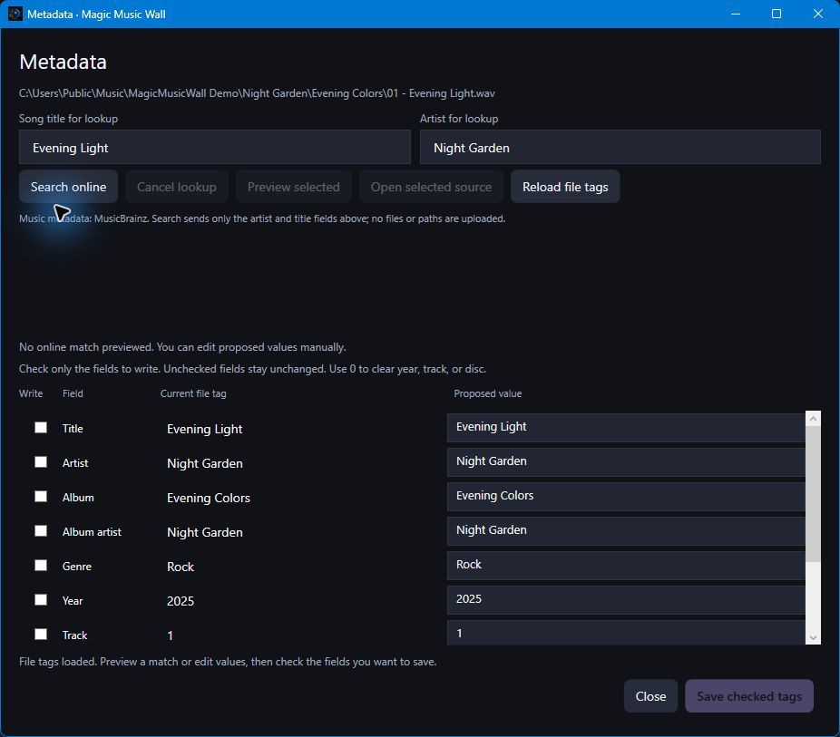

# Find information and edit file tags

Applies to Magic Music Wall **0.9.10**.

[Documentation home](README.md)

Metadata describes a song or video, such as its title, artist and album. Magic Music Wall reads file tags, can save additional MusicBrainz information in its own library, and can write selected file-tag changes after you review them. Saving library information and editing a media file are separate actions.

## Save MusicBrainz information in your library

Open **Music constellation → MusicBrainz info** for the whole music library. In the constellation's details, **MusicBrainz for this selection** limits the window to the selected artist, album or song. The song-information viewer also has **MusicBrainz library info…** for one song.

Select a song in the list. The right-side **Find match** tab contains the search fields and recording candidates; **Saved info** shows the information already stored for that song. **Album for search (optional)** starts with the song's saved album and helps narrow versions. Clear or correct it if that album tag is wrong; editing search fields changes the lookup only.

| Action | What it does |
| --- | --- |
| **Lookup missing** | Searches rows without saved MusicBrainz information. Strict, unique matches can be saved automatically; uncertain results stay **Needs review**. |
| **Search selected song** | On **Find match**, searches using the editable artist/title and optional album fields. Compare candidate recording, album and duration before accepting a result. |
| **Use selected match** | Saves the recording/release you reviewed to this app's library, then opens **Saved info**. |
| **Refresh saved** | Refreshes already-saved rows in the current scope using their existing recording/release IDs. It does not select a new match. |
| **Remove saved info** | On **Saved info**, removes the selected song's saved MusicBrainz information from the library. |
| **Cancel** | Stops the active batch while keeping completed saves. |

Automatic saving requires matching artist and title, known durations within three seconds, and a matching album when your library already has one. Exactly one distinct recording ID must pass those checks. Partial or truncated MusicBrainz result sets remain **Needs review**, even if one visible candidate appears suitable. If the library has no album, an automatic match stores recording information without choosing an arbitrary release; choose an album explicitly through candidate review when needed. Similar names, alternate versions, unknown durations and multiple qualifying recordings need your review.

**Lookup missing** skips saved rows, so you can rerun it after cancellation. Unresolved rows remain missing and may be searched again. **Refresh saved** updates only already-saved rows; to correct a wrong match, use **Find match → Search selected song** and review another candidate. A provider busy/error response pauses the batch and keeps completed saves. MusicBrainz requests share a one-request-per-second limit across the app, and a song can need several requests.

Saved information includes available recording/artist/album details, genres, community labels, instrument/performance credits, source links and retrieval information. It is stored with each library item in `library.json`, separately from its original file tags. The constellation uses these saved genres, labels and credits in **Metadata** and **Blended** connections and search; **Sound** continues to use local audio features. These community descriptions can be incomplete or debatable and are not audio-derived facts. Missing instrument credits do not establish that an instrument is absent. Follow the displayed source links when checking a result.

If a file-tag edit or rescan changes a song's artist/title identity, its saved MusicBrainz match is cleared. An album change, including an album override, clears a saved match that included a selected release; recording-only matches are retained. Review the changed song or run **Lookup missing** to save a suitable match again. Editing the search fields alone does not change the song's library identity or tags.

Opening the app, constellation or MusicBrainz window does not start a lookup. Starting **Lookup missing**, **Refresh saved**, **Search selected song** or accepting a candidate can make online requests. Searches send artist/title text and the album text when provided; detailed lookups use MusicBrainz IDs. Duration comparisons happen locally; no music file or local path is uploaded. Saving or removing this information does not write media-file tags, and the saved results remain usable offline.

MusicBrainz contributors supply the metadata. [Core MusicBrainz data is CC0; supplementary data, including tags and genre associations, uses CC BY-NC-SA 3.0](https://musicbrainz.org/doc/MusicBrainz_Database). See the [MusicBrainz data-license page](https://musicbrainz.org/doc/About/Data_License) for the source terms. Those provider terms apply to the supplied metadata independently of this application's license.

## Find information without changing a file

Select a song and open **Song info / lyrics** from the toolbar or right-click menu. **Song info** beside the player controls opens the current song. Correct the lookup artist/title if necessary; changing those search fields does not edit the file.

| Viewer | What to do |
| --- | --- |
| **Info & albums** | Click **Look up song & albums**, inspect MusicBrainz results, and open a source link when needed. |
| **Lyrics** | Read local lyrics first; use **Find lyrics online** for LRCLIB suggestions. Compare album and duration when multiple versions appear. |
| **Song facts** | Click **Find song facts**, choose the matching Wikipedia article, then **Read selected article**. Follow its source link for the full article. |

**Use selected album** in the information viewer saves an album override in this app's library only. It survives rescans and does not edit the media file. **Restore album from file tag** removes that override. If another program changed the file's tags, rescan first to refresh the indexed values.

Local lyrics can be embedded in the file, or in a `.lrc` / `.txt` file beside it with the same base name. For example, `First Light.flac` can have `First Light.lrc`. The lyrics viewer displays text; it does not highlight lines in time with playback. Missing lyrics or article matches are reported rather than invented.

## Write artist, album and other tags

1. Select one song or video and click **Edit file tags**. This is also on the collection/queue right-click menus and inside the song-information window.
2. Click **Search online** using a clean artist/title. Remove file extensions, track-number prefixes or release-group text from the search if it prevents a match.
3. Select the correct recording/release and click **Preview selected**.
4. Compare **Current file tag** with **Proposed value**. Edit values if needed and check only the fields you want to write.
5. Click **Save checked tags**. Read the filename and before/after changes in the confirmation, then choose **Save these changes**.



Online matches are suggestions. A song can appear on an original album, a compilation and several remasters with different years. Choose the release that matches your copy. You can leave an uncertain field unchecked.

MusicBrainz suggests title, artist, album and release year where available. You can also manually edit album artist, genre, track, disc and comment. A checked empty text value clears that field; a checked numeric value of `0` clears year, track or disc. Unchecked fields stay unchanged.

### Example: correct an album

Suppose the file is `D:\Music\The Example Quartet\Evening Sessions\01 - First Light.flac`, but its album tag is empty. Find the matching release, preview it, and check **Album** only. Keep **Title**, **Artist** and **Year** unchecked if their existing values are already correct. The confirmation then lists just the Album change.

Writing an Album tag also clears that file's earlier library-only album override, so the app shows the newly written tag. File IDs and playlist references are preserved.

## Movie lookup

Movie lookup uses TMDB and needs your own **API Read Access Token**:

1. Open **Setup → Metadata**.
2. Click **Open TMDB API settings** and obtain a token through your TMDB account.
3. Paste the long **API Read Access Token**, not the shorter API key, into the app.
4. Click **Save settings**, then open a video's **Edit file tags** window and search its title.


The token is encrypted for your Windows account. Leave the box blank to keep an existing token; check the removal option to clear it on save. A portable copy moved to a different Windows account may require entering the token again.

Movie suggestions contain title, release year, genre names and an overview. The overview is saved in the **Comment / overview** field. This version searches movies; it does not match individual TV episodes. Movie lookup remains unavailable until a valid token is configured.

## Formats and backups

| Format | File-tag writing in this editor |
| --- | --- |
| MP3, FLAC, M4A | Enabled; the actual file and selected tags are checked before replacement. |
| MP4, M4V | Enabled for supported containers/tags. |
| OGG, OPUS, WMA, WMV, WAV, AIF, AIFF | Enabled, subject to successful tag verification. |
| MKV, WebM, AVI and other formats | Lookup/read-only here. Playback may still work through VLC. |

After confirmation, playback of that file stops if necessary. The app edits a working copy, verifies the tags, and replaces the original only after those checks pass. It does not rename files or transcode the media.

Every successful save leaves a full backup beside the file:

```text
First Light.flac
First Light.flac.mmw-backup-<unique-id>.bak
```

Keep enough space for a working copy and backup, especially for large movies. Backups remain until you manage them yourself and are not imported as music. The writer also checks preservation of existing common tags, lyrics, artwork bytes and track/disc totals. The backup is still your recovery copy.

To restore manually, close Magic Music Wall and other players, preserve the edited file elsewhere, then rename the chosen backup to the original filename. Reopen the app and rescan. Check that you have selected the correct backup before changing names.

A locked, read-only, missing or unsupported file cannot be saved. Some network shares do not support the required atomic file replacement. The app reports the failure rather than falling back to a direct overwrite; see [tag-save troubleshooting](TROUBLESHOOTING.md#tags-will-not-save).

## Online sources and privacy

Online searches happen only when requested. They send search text to the selected provider, including artist/title and an optional album for MusicBrainz library searches; media files and local paths are not uploaded. These are source-based lookups, not AI-generated facts. Provider coverage, availability and response times vary.

| Provider | Use |
| --- | --- |
| [MusicBrainz](https://musicbrainz.org/doc/MusicBrainz_API) | Music recordings, artist/album names, release dates, and optional saved genres, community labels and instrument/performance credits. No key is required. |
| [TMDB](https://developer.themoviedb.org/docs/authentication-application) | Optional movie metadata with your token. |
| [LRCLIB](https://lrclib.net/docs) | Optional lyric matches. |
| [Wikipedia / MediaWiki](https://www.mediawiki.org/wiki/Extension:TextExtracts) | Article excerpts with source/contributor attribution. |

The phone/web viewers are read-only. MusicBrainz library enrichment and file-tag editing are performed in the Windows app; its updated library appears in the remote afterward. No background or bulk tag rewriting is performed.

[Third-party notices](../THIRD-PARTY-NOTICES.md) describe provider content and component licenses. This product uses the TMDB API but is not endorsed or certified by TMDB.
