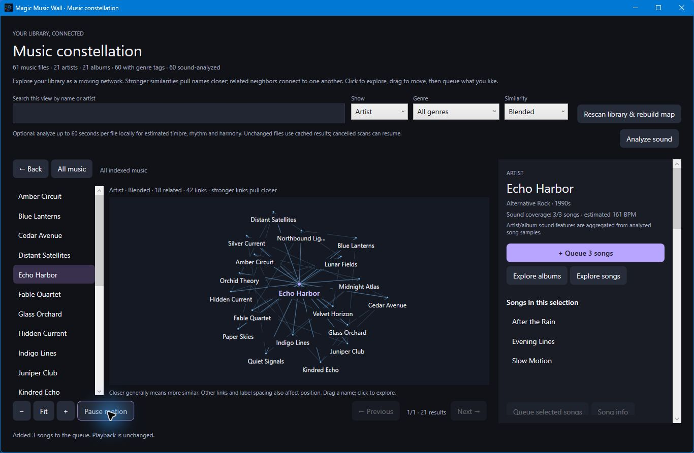

# Explore your music constellation

Applies to Magic Music Wall **0.9.7**.

[Documentation home](README.md)

The **Music constellation** is an animated network of artists, albums and songs already in your library. Select a name to explore its connections. Links act like springs: stronger relationships pull names closer, and related neighbors form groups as the network settles. It opens in a separate window, so you can keep using the main player.

## Open and explore

1. Click **Music constellation** on the left side of the Windows player.
2. Choose **Artist**, **Album** or **Song** under **Show**. Search by name, artist or album; saved MusicBrainz labels and credits also help find music. Use **Genre** to narrow the results.
3. Choose **Metadata**, **Sound** or **Blended** under **Similarity**, then select a result in the list. The network shows that selection and related items, with labels explaining each connection. **Blended** works from saved tags before any sound analysis is available.
4. Click another name in the network or the related-items list to explore from there. Clicking without dragging selects that music; it does not add it to the queue. Use **← Back** to revisit a selection.
5. For an artist, choose **Explore albums** or **Explore songs**. Choose **All music** to return to the full library scope.

The result list is paged so a large collection remains usable. **← Previous** and **Next →** move through the matching results; they do not skip library files during indexing. Use **+**, **−** and **Fit** to adjust the map. Drag empty map space to pan.

## Start from the music you are using

Opening or reopening the constellation focuses on the current music, then the selected queue/library item, selected/open indexed folder, or first queued song. Artist/Album/Song view changes preserve the musical selection. Folder focus limits the map to its indexed music. With no available context, the alphabetical list remains the fallback.

The current track has priority over a different highlighted queue item. This focus is applied when you open or reopen the map; it does not continuously follow every playback change while you explore. Click **Music constellation** in the player again to refocus. Choose **All music** to leave a folder scope.

## Move around the constellation

With motion running, drag a name to move it, then release it to let its connections pull it back into the settling network. Dragging changes the layout without selecting different music or adding anything to the queue. Clicking a name without dragging makes it the new selection.

Use **Pause motion** to hold the layout still and **Resume motion** to let the springs settle again. If animation effects are disabled in Windows, the map starts paused. You can still explore using the result list, related-item buttons and **← Back**; these controls work with the keyboard as well as the mouse.

The new layout uses your existing library metadata and cached sound features. You do not need to rescan or repeat sound analysis just to use the animated constellation.

## Add music to the queue

Selecting a name explores it; selection alone does not start playback or add songs.

- **+ Queue … songs** adds the selected artist's or album's songs, or the single selected song.
- In an artist or album's song list, select individual songs and choose **Queue selected songs**. Use Ctrl-click or Shift-click for multiple selections.
- **Song info / lyrics** or **Song info** opens the existing song-information viewer.

Queue actions append to **Up next** without replacing the queue or interrupting the current song. A repeated queue action can add the same songs again. Saved playlists and media files remain unchanged.

## Understand the connections

| Similarity mode | What connects the music |
| --- | --- |
| **Metadata** | Library artist, album, era and genre information, plus available saved MusicBrainz genres, community labels and instrument/performance credits. |
| **Sound** | Similar audio features from locally analyzed samples. Both sides need analyzed audio. |
| **Blended** | Combines available sound evidence with metadata; falls back to metadata when sound analysis is unavailable. |

Sound connections are blue; metadata connections distinguish genre, artist/album and era. Read the connection's explanation in the related-items list or hover over a name. Lines connect the selected music to its neighbors and also show strong relationships between those neighbors.

Stronger links pull their endpoints closer together. Distances are approximate: other connections, space for labels and the settling motion also affect positions. The layout is not an exact two-dimensional measurement of every pair's similarity. Connection strengths are relevance measures, not percentage probabilities that two artists or songs sound alike.

The network and similarity scores are calculated locally from your library and saved information. Optional MusicBrainz lookups need internet access when you start them; the saved results can be used afterward without another request. No MusicBrainz API key is required. The constellation does not use the Music-Map/Gnod recommendation database or an AI service, and artists missing from your collection are not added as recommendations.

All indexed music is represented, including individually added files and entries on disconnected drives. Videos are excluded. The network shows the selected item and up to 18 related neighbors so the display stays readable; searching and paging still reach the whole indexed music collection.

Files with missing metadata remain visible. Unknown artist or album entries use their source folder to avoid combining unrelated releases. Missing genre tags do not create invented relationships. The coverage line reports how many music files have genre tags and how many have sound analysis.

## Add MusicBrainz information

1. Click **MusicBrainz info** at the top of the constellation to work with all music in your library. To work with one artist, album or song, select it and click **MusicBrainz for this selection** in its details.
2. In the MusicBrainz window, click **Lookup missing**. Songs that already have saved MusicBrainz information are skipped. A strict, unique match can be saved automatically; uncertain matches remain **Needs review**.
3. To review a song, select its row and open the right-side **Find match** tab. Check the artist/title fields and **Album for search (optional)**. The album starts with the saved value to narrow versions; clear or correct it if the old tag is wrong. Click **Search selected song**.
4. Compare the candidate recording, album and duration with your copy, then choose **Use selected match**. The window switches to **Saved info** after saving. Editing search fields does not change file tags.
5. Use **Refresh saved** to update information for already-saved rows in this window's scope. It retrieves their saved recording/release IDs; use **Search selected song** when you want to choose a different match. On **Saved info**, **Remove saved info** removes the selected song's saved MusicBrainz details from the app.
6. Click **Cancel** to stop a batch. Completed saves remain. Run **Lookup missing** again to continue with songs that still have no saved information, including unresolved review rows. A busy or failing provider pauses the batch so you can try again later.

MusicBrainz requests are spaced at least one second apart across the app. A song can need several requests, so a large library can take time. Opening the constellation, opening the information window, starting the app, or rebuilding the map does not automatically start online lookups.

Automatic saving requires matching artist and title, known durations within three seconds, and a matching album if your library already has one. Only one distinct recording ID may satisfy those checks. Partial or truncated MusicBrainz result sets remain **Needs review**. If the local album is missing, an automatic match saves recording information without choosing an arbitrary album. You can choose a recording/release explicitly during review. These checks reduce accidental matches but do not prove that a remaster or live version is the one you own.

Saved genres, community labels and instrument/performance credits improve **Metadata** and **Blended** connections and constellation search when MusicBrainz has that information. **Sound** continues to use local audio analysis. Community labels describe contributors' knowledge or opinions; they are not inferred from your audio, and missing labels or credits remain missing.

Information is stored in the app's `library.json`, separately from the media files' original tags. It includes source links and retrieval information. MusicBrainz enrichment does not write tags, rename files, or upload media. Searches send artist/title text and optional album text; subsequent requests use MusicBrainz IDs. The saved results remain available after cancellation or a restart. See the [metadata guide](METADATA.md#save-musicbrainz-information-in-your-library) for attribution and the difference between library information and file-tag editing.

A tag edit or rescan that changes a song's artist/title identity clears its saved MusicBrainz match. Album changes clear a saved match when it included a selected release; recording-only matches remain. Review changed songs before relying on their enriched connections again.

## Analyze the sound of your collection

1. Click **Analyze sound**. This optional scan reads up to the first 60 seconds of each available music file locally. It does not upload or modify your music.
2. Follow the progress count. **Analyzed** means a new result was calculated; **Cached** means an unchanged file reused its saved result. Unreadable or unsupported files appear in the skipped/failed count.
3. Use **Cancel analysis** whenever needed. Completed results are retained. Closing the constellation also cancels its active sound scan.
4. Choose **Analyze sound** again to resume. Unchanged cached files are skipped, and previously failed or newly added files are tried again.
5. Select **Sound** or **Blended** to explore the results. The map reloads saved results when analysis finishes or is cancelled.

Analysis estimates timbre, rhythm, harmony, energy and tempo from the sample. The details panel shows sound coverage and an estimated BPM when available. Artist and album features aggregate their analyzed songs; partial coverage is shown so one analyzed song is not mistaken for a whole-discography analysis.

A quiet introduction may differ from the rest of a song. Tempo estimates can be half or double the perceived beat, and energy can reflect mastering loudness. These features do not establish mood, lyrical meaning, a definitive musical key or whole-track similarity. Use the connections as a way to explore and audition your own collection.

The bundled VLC decoder and local C# analysis require no Python installation or additional service. Results are saved as `music-audio-features.json` in the application data folder shown in **Setup → TV & data**. File path, size, last-write time and analysis version determine whether a cached result can be reused. `music-audio-scan.txt` records a bounded failure report (up to 100 failures).

## Keep the constellation current

Opening the window builds a snapshot from the current library index. Adding/removing library entries or editing their metadata through the app refreshes the constellation when it is open. The app tries to preserve your selected item when it still exists.

Click **Rescan library & rebuild map** to scan configured library folders for external changes and rebuild the map. The main player's scan cancellation remains available. The app does not watch folders continuously, so files added or tags edited outside the app need a rescan before the map reflects them.

Library rescanning and sound analysis are separate operations. After adding or changing music, use **Analyze sound** to calculate features for new or changed files; unchanged results remain cached. Opening or refreshing the map does not automatically start a sound scan.

Building or refreshing the constellation does not change the playback queue. Mapping an unavailable file does not make it playable: reconnect its drive or share before queuing it for playback.

For better connections, add and review MusicBrainz information or correct your file tags using the [metadata guide](METADATA.md). Saving or removing library information refreshes the constellation; file-tag changes made outside the app require a rescan.
