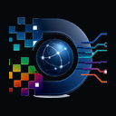

# Magic Music Wall documentation

Magic Music Wall plays music and videos you already own through a Windows PC, its connected Bluetooth output, or a browser on your home network. These guides cover version **0.9.18**.

| I want to… | Open this guide |
| --- | --- |
| Get from installation to my first song and playlist | [Start here](GETTING-STARTED.md) |
| Understand what the app can do and where data is saved | [Common questions](FAQ.md) |
| Install the app or carry it on a USB drive | [Windows installer and USB guide](WINDOWS-INSTALLER.md) |
| Add music, browse folders, play songs and make playlists | [User guide](USER-GUIDE.md) |
| Explore related artists, albums and songs in my collection | [Music constellation](MUSIC-MAP.md) |
| Fold away sidebar tools and view music-reactive animations | [Playback visuals](PLAYBACK-VISUALS.md) |
| Save MusicBrainz library information, find lyrics/facts, or write file tags | [Metadata guide](METADATA.md) |
| Control the PC or listen from a phone/browser | [Web remote guide](WEB-REMOTE.md) |
| Fix missing files, silent playback or connection problems | [Troubleshooting](TROUBLESHOOTING.md) |
| Ask AI for playlists or save AI song notes | [AI playlist assistant](AI-PLAYLISTS.md) |
| Build the source or create release packages | [Developer build guide](BUILDING.md) |

Start with **[Get started](GETTING-STARTED.md)** if this is your first time. You do not need a developer account, .NET SDK, separate VLC installation, Alexa, or ESP32 hardware to use the Windows application. Movie metadata lookup is optional and needs your own TMDB token.

These are the current online guides for 0.9.18. An existing installer or portable download contains the documentation snapshot made when it was packaged; later documentation improvements appear here first.

The screenshots use demonstration content. Your folder names, playlists and audio devices will be different.

[Project overview](../README.md) · [Changes](../CHANGELOG.md) · [Third-party notices](../THIRD-PARTY-NOTICES.md)
