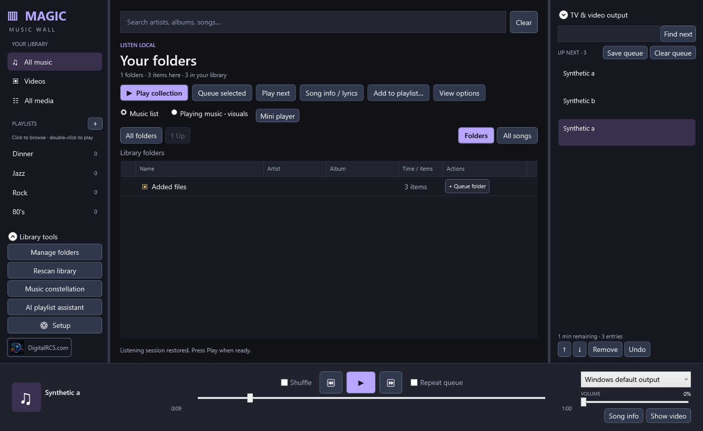
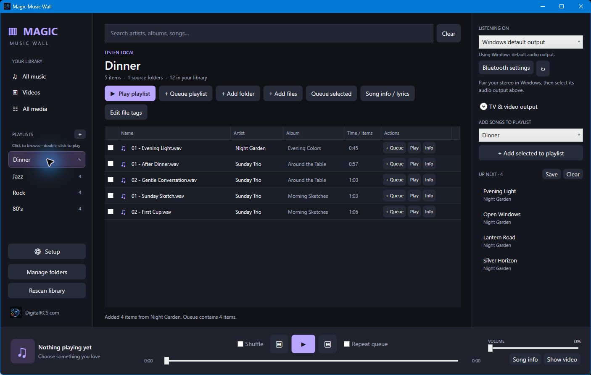

# Listen to your collection

Applies to Magic Music Wall **0.9.17**.

[Documentation home](README.md) · [Install first](WINDOWS-INSTALLER.md)

## Make room and watch your music

Click **Library tools** at the bottom left to hide or show the tool buttons and give playlists more space. Above the center collection, choose **Playing music · visuals** and select a style. Use the vertical **Visual power** slider beside the animation to adjust all styles from 0.5× to 3.0×; your preference is saved and audio volume is unchanged. Choose **Music list** to return to browsing. The [playback visuals guide](PLAYBACK-VISUALS.md) explains all ten modes, audio outputs, and reconnecting.

## Connect a speaker or stereo

1. Open **Bluetooth settings** from Magic Music Wall and pair/connect your receiver in Windows. For wired speakers, make sure Windows can play through them.
2. Return to the app and refresh the output list with **↻**, or use **Setup → Sound → Refresh outputs**.
3. Select the device under **Listening on**. Start at a comfortable volume.
4. Add and play a song using the steps below.

The device's name in the list does not by itself prove that a Bluetooth connection is healthy. If sound is choppy or absent, use the [audio troubleshooting steps](TROUBLESHOOTING.md#no-sound-or-the-wrong-output).

## Add music and play it

**Playback timeline:** click anywhere on the bottom playback bar to jump there, or drag while watching the time preview. Release to seek; press Escape to cancel a drag. Time marks below the bar adapt to the song/video length and window width. Arrow keys move five seconds and Page Up/Down move fifteen seconds. Seeking is unavailable for media that cannot seek.

**Shuffle:** turning on Shuffle during playback takes effect on the next song, including desktop Next, web-remote Next and automatic advancement. A random remaining entry moves into the next queue position, leaving already-played entries in place. Repeat starts another pass when the queue ends. Turning Shuffle off resumes the visible queue order. If only one unplayed entry remains, that is the next song; Shuffle does not replay earlier entries unless Repeat is on.

1. Open **Manage folders**, click **Add folders…**, and choose a folder such as `D:\Music`, or choose **Add files…** in that window to add particular songs. The app catalogs your choices; files remain in their original locations.
2. In **Folders**, click a folder name to enter it. Opening a folder adds nothing to the playback queue.
3. Click a song's filename or **+ Queue** to append only that song. Press the bottom **Play** button to start the queue, or use the separate **Play** button on the song's row to play it immediately.
4. Use **Play folder** when you want every song in that folder and its subfolders. **Up next** is your current playback queue; saved playlists are separate.



Example folder structure:

```text
D:\Music\
  The Example Quartet\
    Evening Sessions\
      01 - First Light.flac
      02 - After Dinner.flac
  Weekend Mix\
    Summer Drive.mp3
```

Add `D:\Music` once to include those subfolders. You can also add a USB folder or a network share that your Windows account can already access.

The grid shows only folders/files represented in your added library. It does not browse every folder on the hard drive. Individually added files outside a source folder appear under **Added files**.

## Find a folder, artist or album

For a visual way to explore the collection, click **Music constellation** on the player's left side. Search for an artist, album or song, select it to view related music, and follow another name to explore further. Choose **Metadata**, **Sound** or **Blended** similarity. Optional **Analyze sound** samples up to the first 60 seconds of files locally, keeps cached results and supports **Cancel analysis** and later resumption. Queue the whole selection or individual songs without replacing the current queue. **Rescan library & rebuild map** updates the constellation after external folder/tag changes; sound analysis is a separate action for new or changed files. See the [music constellation guide](MUSIC-MAP.md) for controls, coverage and the limits of sample-based comparisons.

| Control | What it does |
| --- | --- |
| **Folders** | Browse the added library's folder hierarchy. |
| **All songs** | Show individual tracks for the current collection. |
| **All folders** | Return to the library roots. |
| **↑ Up** | Move up one level. |
| Search box | Match artist, album, title, genre and folder/path text. |
| **Clear** beside search | Clear the search and return to browsing. |
| **Rescan library** | Read the added sources again to find new files and refresh tags. |

Searching a collection covers all its library folders, even if you were inside one folder. Searching a selected playlist stays inside that playlist. All words must match somewhere in the item's information; for example, `quartet evening` can match an artist and album together.

Scanning does not move or delete media. If a USB drive or share is disconnected, its saved entries remain. Reconnect it and rescan. Scans are manual unless you enable **Rescan library folders when the app starts** in Setup.

## Make a playlist

**Dinner**, **Jazz**, **Rock**, and **80's** start as empty playlists. You can make as many named playlists as you need.

### From selected songs

1. Find the songs you want and check their boxes. Ctrl/Shift selection on rows also works.
2. Click **+** next to **Playlists** on the left.
3. Enter a name, such as **Dinner**, and choose **Selected songs** under **Start with**. Use a different name if that playlist already exists.
4. Click **Create**. The new playlist opens with those songs and becomes the destination on the right.

### Add more songs later

1. Return to **All music** and select the songs.
2. Under **Add songs to playlist** on the right, choose the destination playlist.
3. Click **Add selected to playlist**.

Choose the destination on the right after selecting songs. Clicking a playlist in the left sidebar changes what you are browsing.

### Save the current queue

Click **Save** above **Up next**, enter a new playlist name, and confirm. The saved playlist opens; the current queue/playback continues. The left-side **+** dialog also offers **Current queue** when it contains songs.



### Play a saved playlist again

- Click its name on the left to see its songs. Opening it clears the previous view's search filter.
- Click **Play playlist**, or double-click its sidebar name, to load and play it.
- Click **Queue playlist** to append it without interrupting the current song.
- If you search inside it, the buttons become **Play matches** / **Queue matches** and use the displayed matches.

Clearing **Up next** does not delete the saved playlist. Open that playlist and use **Play playlist** to load it again. With that playlist open and an empty queue, the bottom Play control also reloads it.

Right-click a playlist name to rename/delete it. Right-click a track while browsing a playlist to move it up/down or remove it from that playlist. Clear search when arranging the full saved order. Deleting a playlist does not delete its media files.

## Manage the current queue

The queue is the order of items you are playing now. **Queue selected**, **+ Queue** and **+ Queue folder** append items; explicit Play actions can replace the queue with the items being started.

Right-click a queue item to move or remove it, open **Song info / lyrics**, or **Edit file tags**. **Clear** empties the queue. Save it as a playlist if you want to reuse it later.

Use the bottom controls for previous/next, pause, position, volume, shuffle and repeat. Shuffle applies when starting a new queue. The app saves your volume, selected output, shuffle and repeat preferences.

## Play a video or use a TV

Choose **Videos** in the sidebar. A video's **Play** button opens local video playback in another window; **Show video** returns to that window. Closing the video window hides it, while transport controls remain in the main player.

For Chromecast, expand **TV & video output**, click **Find / refresh Chromecasts**, and choose a reachable receiver. Previously found devices remain listed and can be marked unavailable. Selecting **This PC** returns playback to the PC. Receiver discovery does not prove that a particular file will cast successfully.

For Fire TV or another network player, select a file and choose **Share file to Fire TV / VLC**. Select a reachable PC address and click **Start sharing this file**. Open the displayed URL in a compatible network player on the TV. Keep the app open; **Stop sharing** ends access. The receiving player must support the file's codecs, because this sharing mode does not transcode it.

See [web playback](WEB-REMOTE.md) to watch in a browser. Physical TV playback depends on the receiver and has not been verified on every model.

## Save configuration in Setup

Open **Setup** and choose the tab for the setting you want. Click **Save settings** to apply changes made there.

| Tab | What you can configure |
| --- | --- |
| **Sound** | Preferred audio output, volume, shuffle for new queues, and queue repeat. Windows handles Bluetooth pairing. |
| **Library** | Add/manage source folders, rescan now, and choose whether to rescan at startup. |
| **Metadata** | Optional movie lookup token and provider information. Music lookup needs no API key. |
| **Remote** | Enable the web page, allow browser playback, set a sign-in passphrase, choose a PC address/port, and copy the web address or QR access links. |
| **TV & data** | Choose defaults for file-sharing address/port and open the active library/settings folder. A sharing port of `0` selects an available port. |

Changes to folders/playlists and the main player's output, volume, shuffle and repeat are also saved as you use them. A Chromecast selection applies to the current session. File sharing starts only after **Start sharing this file**; saving its defaults does not start it.

## Keep your collection safe

- **Manage folders → Add folders…** opens the folder picker. Select one or more folders to import; the source list refreshes when the scan finishes. The same control is available through **Setup → Library → Manage folders**.
- **Manage folders → Add files…** imports selected songs or videos. Files outside a managed source appear under **Added files**. Both import controls are located in Manage folders rather than the main playback toolbar.
- **Manage folders → Remove selected source** removes that source and its tracks from the library, saved playlists and PC queue. Tracks still covered by another managed folder remain. Files on disk are never deleted.
- **Manage folders → Clear added files** removes all entries outside your remaining managed folders, including tracks left under **Added files** after removing a source in older versions. This keeps the files on disk and does not remove tracks inside managed folders.
- **Remove from library (keep file)** removes selected catalog entries, playlist references and PC queue entries. To clear selected added files, open **Added files**, select the tracks (Ctrl+A selects all visible tracks), and use this command. Clear a search/filter first if you want every track. Rescanning a managed folder can import its removed entries again.
- If a removed track is playing on the PC, playback stops. Old browser links cannot reopen removed tracks; audio already delivered to a browser may remain buffered there.
- Metadata lookup does not write tags until you explicitly confirm **Save checked tags**. See the [metadata guide](METADATA.md).
- Keep a backup of your active data folder and a separate backup of your media. **Setup → TV & data** shows the data location.

For phone controls, QR codes and independent browser listening, continue to the [web remote guide](WEB-REMOTE.md).

Double-click a track in **Up Next** to play that queue position. Scrollbar arrows, the scrollbar track/thumb, and empty queue space only navigate the list; they do not restart playback.
