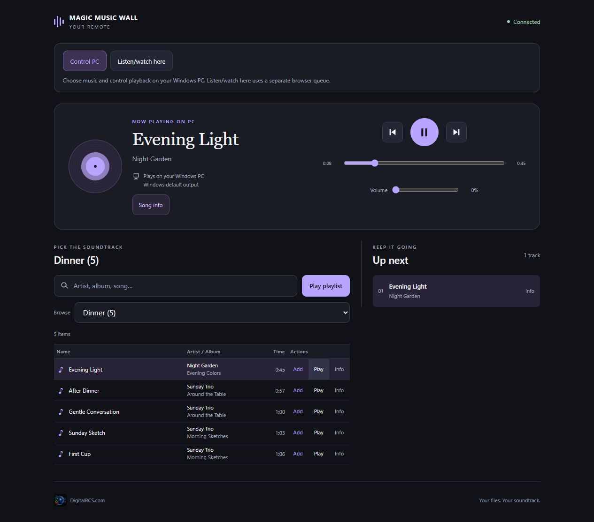
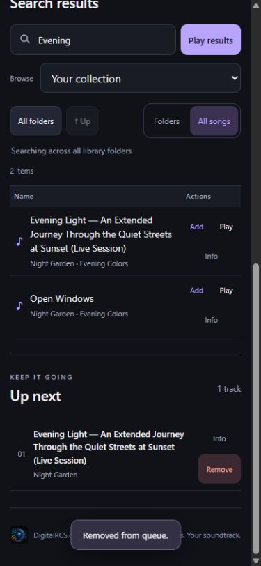

# Control the PC or listen in a browser

Applies to Magic Music Wall **0.9.15**.

[Documentation home](README.md)

The web remote is a page served by Magic Music Wall while the Windows app is open. It works on reachable devices on your trusted home network. There is no cloud server or router-forwarding setup.

## Connect a phone or another PC

1. Open **Setup → Remote** in the Windows app.
2. Enable **Run the web remote whenever this app is open**.
3. Choose the PC's home-network address, or **Automatic**. The default web port is `8787`.
4. Under **Sign in at the plain web address**, enter a passphrase of **8–128 characters**, then repeat it in **Confirm new passphrase**. Choose a memorable passphrase unique to this app.
5. Click **Save settings** and confirm that Setup reports the remote is running.
6. Click **Copy web address**. Open that plain address on your phone or another PC, enter the passphrase, and choose **Connect to your music**. No access key is needed in the URL.
7. Leave **Remember this browser for 30 days** checked if this is your device and you want later visits to open without signing in again.

You can bookmark the plain address. Without **Remember this browser**, access lasts for the browser session, up to eight hours. Remembered access survives an ordinary restart of the Windows app. It still requires the app to be running at the same reachable address.

Existing **Show QR code**, **Copy remote link**, and listening links also work. They include a quick access key and do not require the passphrase.

The other device must be able to reach the PC. A guest Wi-Fi network may isolate devices even when both have internet access. If Windows asks about network access, allow only the private network you intend to use.

Leave the app open, keep the PC awake, and keep the media drives connected. Closing the app stops the remote. When enabled in Setup, the remote starts on later app launches.

## Choose where playback happens

| Mode | Sound/video plays on | Queue used |
| --- | --- | --- |
| **Control PC** | The Windows app's selected output, such as its Bluetooth stereo | The PC's **Up next** queue |
| **Listen/watch here** | This phone, tablet or browser | That browser's independent queue |

In **Control PC**, selecting one file queues only that file. Use its separate Play action for immediate playback. **Play folder** includes subfolders; **Play collection** plays the full current library collection.

In **Listen/watch here**, use the browser's audio/video controls. **Play listed tracks** plays only the displayed results, up to 500. It does not recursively collect songs from folders below the one you opened. Browser listening does not restart or control the PC's playback.

Use **Copy listening link** or **Listening QR code** in Setup to open the page with browser playback selected. The browser may still require a tap before it can start sound or video.

## Remove a queued item

Tap **Remove** beside the item in **Up next** or **This browser’s queue**. It removes only that queue entry; it does not delete the media file or change a saved playlist. The PC and browser queues remain separate.

Removing another item leaves the current song playing. Removing the current item starts the next item, or the previous item if the removed item was last. Removing the final item stops playback and leaves an empty queue. If another controller changed the queue first, refresh it and try again.

## Browse and view song information

The remote has **Folders / All songs**, **All folders** and **↑ Up** controls. Opening a folder only navigates. Collection searches cover all its library folders; a selected playlist keeps its own search scope. Narrow searches when more than 500 results match.

Long song and folder names wrap onto multiple lines in the directory and queue. On a phone, artist and album appear beneath the song name, leaving more room for the title. You do not need to drag a column heading to read it.

Tap **Song info** for the current track, or **Info** beside a library or queue song, to read saved details and local lyrics. The dialog also offers online albums, lyrics and song facts. These viewers do not write media tags; use the Windows app for that.

## Understand browser format support

Browser listening sends the original file with seek support; it does not convert it. A file that plays on the PC through VLC may contain a codec that your browser cannot play. Try a known-compatible file or use **Control PC** with the PC's player. TV file sharing has the same receiver-codec limitation.

Turn off **Allow music and video playback in web browsers** and save if you want the page to control the PC only.

## Manage sign-in and access links

Anyone with the passphrase or a full remote/listening link who can reach the PC can control playback and, when enabled, stream library files. Treat full links and QR codes like keys. Do not include passphrases, live access links or QR codes in public screenshots, issue reports or documentation.

To change the passphrase, enter and confirm a new one in **Setup → Remote**, then **Save settings**. Leaving both fields blank keeps the saved passphrase. **Remove saved passphrase when saving** disables passphrase sign-in; QR links still work.

Changing or removing the passphrase revokes remembered browser access. Other devices can sign in again with the new passphrase or use an existing quick access link. **Replace access link**, followed by **Save settings**, revokes both old quick access links and remembered browser access. Show/copy a fresh QR link afterward, or sign in with the saved passphrase.

Use **Sign out** on a shared browser when finished. This clears access in that browser; it does not sign out other devices. Clearing browser cookies or using a new browser/private window also requires signing in again.

QR codes are generated on the PC; no external QR service receives the link. The browser removes the access key from its address bar after opening and retains it for that tab. Copy the complete link from Setup when connecting another device.

Browser streams use separate temporary links for individual files. Anyone holding a stream link with network access can read that file while the link remains valid. Stopping/restarting the remote or disabling browser playback and saving invalidates these links, though a browser may finish bytes already buffered.

The remote uses local HTTP and is intended for a trusted LAN. Choose a passphrase you do not use for other accounts. The app does not configure HTTPS, expose arbitrary disk browsing, change your router, or provide internet hosting.

If the page will not connect, see [remote troubleshooting](TROUBLESHOOTING.md#the-phone-page-will-not-open).

## Shuffle when controlling the PC

When **Shuffle** is enabled in the desktop player, the web remote's **Control PC → Next** chooses from the remaining desktop queue entries, just like the desktop Next button. The currently playing song is not restarted when Shuffle is toggled. This does not change the independent **Listen / watch here** queue.

## PC output and queue settings

In **Control PC**, expand **Now playing** to change **Shuffle** and **Repeat queue**. These controls use the same saved settings as the desktop player and update when another controller changes them.

Choose a **PC audio output**, then select **Use output**. **Refresh outputs** reloads the Windows device list. Connect Bluetooth devices in Windows first. Audio-output selection is unavailable while casting; stop casting in the Windows app before selecting a PC output. These controls do not change the phone or browser's audio output in **Listen/watch here** mode.

## Collapse sections

Playback destination, Now playing, Your collection, and Up next have visible borders and clickable headers. Click or tap a header to collapse/expand its section, or focus it and press Enter/Space. The browser remembers each section's state locally. Collapsing a section does not stop playback or clear its contents. If browser storage is blocked, the panels still work but are expanded on a fresh page load.

## Select files and folders to queue

Use the checkboxes beside files and folders in the collection. **Add selected** appends the selection without replacing the queue or interrupting a playing/paused track. **Select shown** selects the displayed entries (up to 500); **Clear selection** unchecks them. Changing folders, searches, playlists, or playback destination clears the selection.

Use **Add** on a folder row to queue that folder, or **Add folder to queue** to queue the open folder. At collection home this becomes **Add collection to queue**. Folders include all indexed tracks in their subfolders, including tracks beyond the visible 500-row browsing limit. Overlapping folders/files in one batch add each track once; tracks already in the queue are not removed or deduplicated. A stale selected item cancels the entire batch instead of adding only part of it.

**Clear queue** in Up next stops playback and empties the active destination's queue. In **Control PC** it clears the desktop queue; in **Listen/watch here** it clears only that browser's queue. Original files, the library, and saved playlists are unchanged. Adding to an empty queue does not start it; select a queued track to play.
