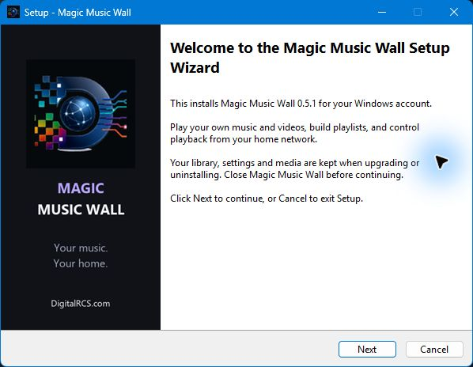

# Install Magic Music Wall or carry it on USB

Applies to Magic Music Wall **0.9.18**.

[Documentation home](README.md)

The normal installer is the easiest choice for a PC you use regularly. The portable ZIP is useful when you want to keep the app and its library data together on a writable USB drive.

## Choose a download

Get the files from the project's [GitHub Releases page](https://github.com/digitalrcs/MagicMusicWall/releases).

| Download | Use it for |
| --- | --- |
| `MagicMusicWall-0.9.18-Setup-x64.exe` | Install on a Windows PC, including from a USB drive. |
| `MagicMusicWall-0.9.18-Portable-x64.zip` | Extract and run without installing. Keep the extracted folder together. |
| `MagicMusicWall-0.9.18-USB-Kit.zip` | Carry the installer, portable ZIP, instructions and checksums in one download. |
| `SHA256SUMS.txt` | Compare downloaded files with the published checksums. |
| GitHub source archives | Developers who want to inspect or build the code. These are not the ready-to-run app. |

The Windows x64 runtime and VLC playback engine are included. Local playback does not require internet access. Online metadata/lyrics/facts searches do require it. No music or movies are included in the download.

This release targets **Windows 11 on Intel/AMD x64 PCs**. The installer permits compatible x64 execution, but Windows on ARM through x64 emulation has not been verified. Audio hardware, Bluetooth drivers and TV/browser codec support still depend on the receiving device.

## Install on this PC

1. Copy or download `MagicMusicWall-0.9.18-Setup-x64.exe` to the PC, or open it from your USB drive.
2. Close any running copy of Magic Music Wall before continuing.
3. Open the installer and follow its pages. The default location is `%LOCALAPPDATA%\Programs\MagicMusicWall` for your Windows account.
4. Choose whether to create a desktop shortcut and register music file types with MagicMusicWall, then finish the installation.
5. Open **Magic Music Wall** from the Start menu or shortcut.



The installer normally does not need administrator rights. It does not copy your music, configure your Bluetooth receiver, or enable the web remote automatically.

The Start menu also has **Magic Music Wall documentation**, which opens the included offline guides.

The installer is unsigned. Windows may display an unknown-publisher or reputation message. Check that you downloaded the intended release and compare its checksum; do not disable Windows security to install it. Follow any restrictions set by your PC's owner or administrator.

## Double-click music files

When **Register music file types with MagicMusicWall** is checked, the installer registers **MagicMusicWall** as a music player for MP3, FLAC, WAV/WAVE, AAC, M4A, OGG/OGA, OPUS, WMA, AIFF/AIF, ALAC and APE files.

1. Install the updated build with **Register music file types with MagicMusicWall** checked.
2. Right-click a music file in File Explorer and choose **Open with > Choose another app**.
3. Select **MagicMusicWall**, then **Always**. Repeat for other file formats you use, or use **Settings > Apps > Default apps**.
4. Double-click a file to load and play it. If Magic Music Wall is already running, it receives the file and restores its window.

By default, opening a file adds it to the library and appends it to an existing playback queue without interrupting the playing or paused track. An empty queue starts playback immediately. In **Setup > Sound**, uncheck **Add external files to the existing queue**, then click **Save settings**, to replace the queue and play opened files immediately instead. Neither choice adds files to the selected saved playlist. The original music file is unchanged. Playback uses the current output and volume; an active library operation finishes before the file is imported. Missing or unsupported files leave the current queue intact and show an explanation.

Leaving the installer association checkbox unchecked skips registration; unchecking it during an upgrade removes MagicMusicWall registrations from an earlier install. Other applications' registrations and Windows default-choice values are not modified. When enabled, installation registers the option without overwriting your existing default. Uninstalling removes MagicMusicWall's registrations. The portable ZIP does not register file types automatically. For a portable command-line launch, use `MagicMusicWall.exe --portable --play "F:\Music\Song.mp3"`; `--data-dir` and `--import` retain their existing meanings.

Developer check: `MagicMusicWall.exe --play "C:\Music\Song.mp3"` (a bare quoted file path also works). Test once with the app closed and again while it is playing, plus a path containing spaces or Unicode and an unavailable file.

## Carry the installer to another PC

1. Copy the installer EXE to a USB drive, or extract the USB kit onto it.
2. Safely eject the USB drive and connect it to the other Windows 11 PC.
3. Run the installer there. The installed application and its settings belong to that PC's Windows account.
4. Connect your stereo, choose its output in the app, and add music folders available on that PC.

Installing on a second PC does not automatically transfer the first PC's library, playlists or media. Use the portable option below if you want to carry the app's library data with it.

## Run the portable copy

1. Extract `MagicMusicWall-0.9.18-Portable-x64.zip` to a writable folder on the USB drive. Do not run the app from inside the ZIP.
2. Keep all extracted files and subfolders together; the player needs its bundled runtime and VLC files.
3. Open **Start-MagicMusicWall.cmd**. This starts portable mode and keeps the library/settings in the adjacent **Data** folder.
4. For music you want to carry, create a **Media** folder inside the extracted app folder and copy your music there. Add it through **Manage folders → Add folders…** or **Add files…**. Other reachable locations can also be added.
5. Close the app before unplugging the USB drive, then use Windows' safe-eject option.

The USB drive needs room for the app, its data, your own media if you copy it there, and any tag-edit backups you create. File-tag editing can temporarily need another full copy of a song or movie.

Move the **whole extracted folder**, including Data and Media. Portable mode updates saved paths for media inside that folder when its location or USB drive letter changes. For example, a song added from `F:\MagicMusicWall\Media\Jazz\First Light.flac` can still be found after the complete folder moves to `G:\MagicMusicWall`.

Music outside the portable app folder, including another PC's internal drive or a network share, is not copied or relocated automatically. Those saved paths must still be accessible, or you must add the new locations. On another PC, choose that PC's audio output in **Setup → Sound**, and recheck the home-network address before enabling the remote. A saved TMDB token is protected for the Windows account that saved it; enter it again on the new PC/account.

The package also includes **OfflineDocs**. Open its `index.html` to read these guides without internet access.

## Update an existing copy

For an installed copy, close the app and run the new installer. Keep the same install location. Your library and settings remain in `%LOCALAPPDATA%\MagicMusicWall`, separate from the program files.

For a portable copy, close the app, back up its **Data** folder, and extract the new portable release into a separate folder first. Keep your existing Data and media when moving to the updated folder. Do not replace your working Data folder with a new empty one.

Use **Setup → TV & data → Open data folder** to find the active library/settings location. An installed and a portable copy can have different libraries; make sure you back up the one you intend to use.

## Uninstall and backups

Uninstall the installed app through **Windows Settings → Apps → Installed apps**. Uninstalling removes its program files and shortcuts, while retaining your library/settings and original media. Keep or remove that retained data yourself after checking your backup.

Back up the active data folder while the app is closed. It holds your playlist references and preferences, not your songs. Back up the media files separately. See [data recovery](TROUBLESHOOTING.md#recover-library-data).

## Verify a download

This optional PowerShell command prints an installer's SHA-256 checksum:

```powershell
Get-FileHash .\MagicMusicWall-0.9.18-Setup-x64.exe -Algorithm SHA256
```

Compare the full value with `SHA256SUMS.txt` for the same release. Matching values show that the file matches the published package; they do not replace your normal software-trust checks.

Installer/package checks during development are not a substitute for testing every Windows 11 PC. A completely fresh Windows VM installation, ARM emulation, and every Bluetooth/TV receiver are not claimed as verified.

Next: [add your music and play a song](USER-GUIDE.md).
